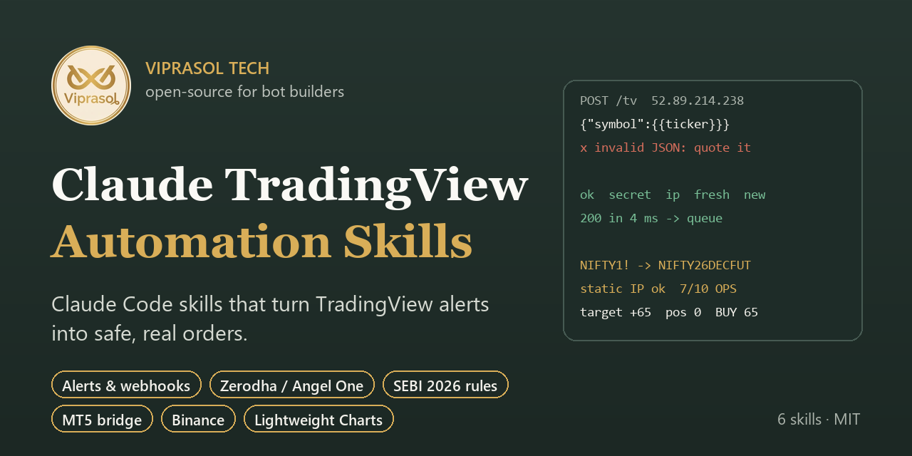

<div align="center">



### Claude Code skills for automating TradingView

**Alerts that don't repaint · locked-down webhook receivers · signal-to-order workers · Zerodha / Angel One / Dhan / Upstox under SEBI's 2026 algo rules · crypto and MT5 bridges · TradingView charts in your app**<br>
From chart signal to broker order without double fills, missed exits or rejected orders.

[](https://github.com/Viprasol-Tech/claude-tradingview-automation-skills/stargazers)
[](LICENSE)
[](https://code.claude.com/docs/en/skills)
[](#-whats-inside)
[](https://github.com/Viprasol-Tech/claude-tradingview-automation-skills/actions/workflows/ci.yml)

[Quick start](#-quick-start) · [What's inside](#-whats-inside) · [Examples](#-just-ask) · [Scripts](#-bundled-scripts) · [Changelog](CHANGELOG.md)

</div>

---

## 💬 Just ask

Install once, then talk to Claude Code normally. The right skill loads by itself.

```text
> Write the alert message for my Pine strategy so my bot gets symbol, side, size and a secret.
> My webhook gets "Expecting value" JSON errors from TradingView. Here's the alert text.
> Build a FastAPI endpoint for TradingView alerts that can't be triggered by anyone else.
> My bot opened a short when the strategy only closed the long. Fix the worker.
> Connect my TradingView strategy to Zerodha Kite. What changed with SEBI's April 2026 rules?
> NSE:NIFTY1! fired - which NIFTY future do I actually buy, and when do I roll?
> Send TradingView alerts to my MT5 account on a Windows VPS.
> Add a Lightweight Charts v5 candlestick chart with my bot's trades as markers.
```

## 📦 What's inside

| Skill | What it does |
| --- | --- |
| 🔔 **`tv-alert-design`** | `alert()` vs `alertcondition()` vs order-fill alerts (and why `alert()` ignores `{{placeholders}}`), bar-close timing so signals don't repaint, every placeholder, a JSON message format with secret, symbol, target position and timestamp, plan limits and the 15-in-3-minutes throttle. Ships a **linter**. |
| 🛡️ **`webhook-receiver`** | What TradingView really sends (ports 80/443, 4 source IPs, 3-second timeout, no signatures, no custom headers), then a 10-point checklist: TLS, IP allow-list, proxy-safe client IP, body secret, NaN-proof schema, stale and duplicate rejection, answer first and trade later. Ships a **reference receiver**. |
| 🔁 **`signal-to-order`** | The worker between queue and broker: target position instead of blind buy/sell, deterministic client order IDs, symbol mapping that fails closed, lot and tick rounding, marketable limits, risk gates, reconciliation and paper mode. |
| 🇮🇳 **`indian-broker-apis`** | **SEBI's retail algo framework (fully live 1 April 2026)**: static IP, 10 orders/second, algo IDs, market protection. Then Zerodha Kite Connect, Angel One SmartAPI, Dhan v2 and Upstox v3 logins, limits and instruments, plus NSE's **Tuesday expiries** and current lot sizes. Ships an **expiry and contract resolver**. |
| 🌉 **`crypto-mt5-bridges`** | TradingView to Binance/Bybit/OKX, and to MetaTrader 5 three ways: EA polling with `WebRequest`, EA sockets, or the Python `MetaTrader5` package, with filling modes, retcodes and broker symbol suffixes. |
| 📈 **`tradingview-charts`** | Lightweight Charts **v5** (Apache-2.0, `addSeries`, UTC seconds, markers, panes, attribution) and the Advanced Charts Datafeed API (ms bars vs second ranges, `noData`, sessions and time zones, UDF). |

Every TradingView, SEBI, NSE and broker fact is taken from official
documentation and linked from each skill's `reference.md`. Points we could
not confirm from a primary source are listed there too.

## ⚡ Quick start

**Option A: Claude Code plugin (recommended)**

```bash
claude plugin marketplace add Viprasol-Tech/claude-tradingview-automation-skills
claude plugin install tradingview-automation@claude-tradingview-automation-skills
```

Skills are then available as `/tradingview-automation:<skill>` and load
automatically when your request matches.

Want every Viprasol plugin? Add the [Viprasol marketplace](https://github.com/Viprasol-Tech/claude-plugins) once:
`claude plugin marketplace add Viprasol-Tech/claude-plugins`, then
`claude plugin install <plugin>@viprasol`.

**Option B: installer** (copies the skills to `~/.claude/skills`)

```bash
git clone https://github.com/Viprasol-Tech/claude-tradingview-automation-skills
cd claude-tradingview-automation-skills
bash install.sh                                        # macOS / Linux
powershell -ExecutionPolicy Bypass -File install.ps1   # Windows
```

No API keys, no accounts. The scripts need only Python 3.10+.

## 🧰 Bundled scripts

Standard-library Python with built-in self-tests.

**`tv_alert_lint.py`** - catch a broken alert before your bot does:

```text
$ python tv_alert_lint.py --message '{"secret":"...","symbol":{{ticker}},"action":"buy"}'
ERROR   {{ticker}} renders as text but is not inside quotes -> invalid JSON
ERROR   rendered message is not valid JSON: Expecting value at char 25: ...'{"secret":"...","symbol":RELIANCE,"actio'...
```

**`tv_webhook_server.py`** - a receiver that checks IP, secret, schema, age and
duplicates, answers in milliseconds and queues the signal:

```text
$ TV_SECRET=... python tv_webhook_server.py serve --port 8080 --queue signals.jsonl
listening on 127.0.0.1:8080, queue -> signals.jsonl
```

**`nse_symbols.py`** - NSE expiries and the exact contract for a TradingView ticker:

```text
$ python nse_symbols.py expiry --month 2026-12 --holidays nse_holidays_2026.txt
monthly  2026-12-29
weekly   2026-12-01 2026-12-08 2026-12-15 2026-12-22 2026-12-29
$ python nse_symbols.py resolve instruments_nfo.csv --name NIFTY --type FUT --front --roll-days 2
tradingsymbol   NIFTY26NOVFUT
```

## 🗂️ Repository layout

```text
.claude-plugin/marketplace.json          marketplace manifest
plugins/tradingview-automation/
  .claude-plugin/plugin.json             plugin manifest
  skills/<skill>/SKILL.md                one folder per skill
  skills/<skill>/reference.md            official sources and open questions
  skills/tv-alert-design/scripts/tv_alert_lint.py
  skills/webhook-receiver/scripts/tv_webhook_server.py
  skills/indian-broker-apis/scripts/nse_symbols.py
tests/validate_repo.py                   CI: manifests, frontmatter, links, scripts
```

## ⚠️ Disclaimer

This project is for **educational and engineering purposes only** and is **not
financial, investment or legal advice**. Automated trading can lose money
quickly through bugs, outages, slippage and missed alerts. Test on paper or
sandbox accounts first and keep risk limits and a kill switch. SEBI, exchange
and broker rules change; confirm them with your broker before going live.
Viprasol Tech is not affiliated with TradingView, SEBI, NSE, Zerodha, Angel
One, Dhan, Upstox, MetaQuotes, Anthropic or any exchange mentioned here.

## 🤝 Contributing

Corrections with a link to the official source are the most valuable
contribution: TradingView, broker APIs and SEBI rules change. See
[CONTRIBUTING.md](CONTRIBUTING.md) and run `python tests/validate_repo.py`
before opening a PR. More free Claude Code packs from Viprasol:
[claude-ml-trading-skills](https://github.com/Viprasol-Tech/claude-ml-trading-skills) ·
[claude-ai-trading-agent-skills](https://github.com/Viprasol-Tech/claude-ai-trading-agent-skills) ·
[claude-market-data-skills](https://github.com/Viprasol-Tech/claude-market-data-skills) ·
[claude-prop-firm-skills](https://github.com/Viprasol-Tech/claude-prop-firm-skills) ·
[claude-options-trading-skills](https://github.com/Viprasol-Tech/claude-options-trading-skills) ·
[claude-trading-skills](https://github.com/Viprasol-Tech/claude-trading-skills) ·
[claude-crypto-bot-skills](https://github.com/Viprasol-Tech/claude-crypto-bot-skills) ·
[claude-india-stack-skills](https://github.com/Viprasol-Tech/claude-india-stack-skills) ·
[claude-fintech-skills](https://github.com/Viprasol-Tech/claude-fintech-skills) ·
[claude-voice-agent-skills](https://github.com/Viprasol-Tech/claude-voice-agent-skills) ·
[claude-video-editing-skills](https://github.com/Viprasol-Tech/claude-video-editing-skills).

## 📬 Contact — Viprasol Tech Private Limited

Need a TradingView strategy automated on Zerodha, Angel One, Binance or MT5,
with the risk controls done properly? That is what we build.

- 🌐 Website: [viprasol.com](https://viprasol.com)
- ✉️ Email: [support@viprasol.com](mailto:support@viprasol.com)
- 💬 Telegram: [t.me/viprasol_help](https://t.me/viprasol_help) · 📱 WhatsApp: +91 96336 52112
- 🐙 GitHub: [@Viprasol-Tech](https://github.com/Viprasol-Tech) · 💼 [LinkedIn](https://www.linkedin.com/in/viprasol/) · 𝕏 [@viprasol](https://twitter.com/viprasol)
- 📈 TradingView: [@viprasol](https://www.tradingview.com/u/viprasol/) · MQL5: [viprasol](https://www.mql5.com/en/users/viprasol)

## License

[MIT](LICENSE) © 2026 Viprasol Tech Private Limited
